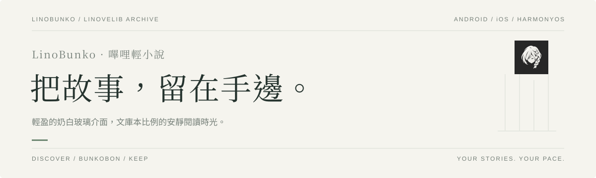
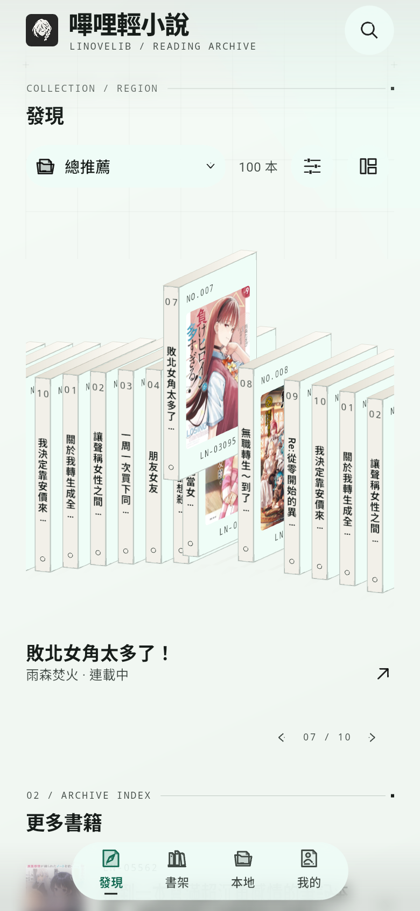
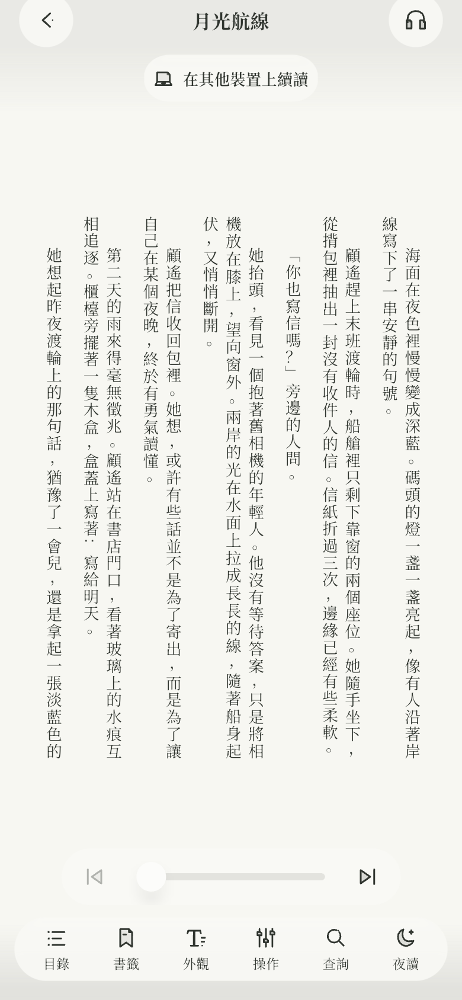

# LinoBunko · 嗶哩輕小說文庫本閱讀器

Cross-platform Flutter light novel reader for **Linovelib (`tw.linovelib.com`)** & **local ebooks (EPUB / TXT / MOBI / AZW3 / PDF / DOCX)** — with Tablet/Mobile **Bunkobon (`105:148`)** layout, Tategaki vertical reading, 3D bookshelf, Edge TTS, and WebDAV/S3 sync.

<p align="center">
  <picture>
    <source media="(prefers-color-scheme: dark)" srcset="docs/images/readme-cover-dark.svg" />
    
  </picture>
</p>

<p align="center">
  <a href="https://github.com/Rynowastaken/LinoBunko/actions/workflows/flutter-ci.yml"></a>
  <a href="https://github.com/Rynowastaken/LinoBunko/releases/latest"></a>
  <a href="https://github.com/Rynowastaken/LinoBunko/releases"></a>
  
  <a href="assets/licenses/GPL-3.0.txt"></a>
</p>

> [!IMPORTANT]
> 本專案為免費開源之第三方閱讀用戶端，無任何付費或贊助管道，亦不附帶或託管任何小說檔案；線上書目僅支援 **Linovelib (`tw.linovelib.com`)** 與本機匯入，不再支援其他或自訂書源。請僅存取有權閱讀之內容並遵守來源站規範。

## 介面預覽

<p align="center">
  
  &nbsp;
  
  &nbsp;
  
</p>

## 核心特色

- **Linovelib 線上整合**：排行、分類、出版文庫、簡繁搜尋（隨包 OpenCC 索引 + Brave 備援 + 官網 CSE）、分卷目錄與插圖、`tw.linovelib.com` 帳號登入、雲端書架雙向同步、推薦投票與書評檢視／發表。
- **文庫本（`105:148`）閱讀版面**：平板與手機直向維持專注單頁、橫向及摺疊屏展開自動雙頁對開；支援橫排、日系直排（Tategaki）與捲動模式、可下載字體（SIL OFL 1.1）與自訂配色。
- **本機書庫與多端工具**：支援 EPUB／TXT／MOBI／AZW3／PDF／DOCX 等格式匯入、立體書架、Edge TTS／系統語音聽書、離線詞典、閱讀統計報告與桌面小工具。
- **獨立更新與上游互通性**：應用內檢查更新直接對接 `Rynowastaken/LinoBunko` Releases；區域網續讀（`_wenkuread._tcp.`）、WebDAV／S3 與本機備份可與上游互通**本機書籍**，線上書目（`LN-` 命名空間）彼此隔離。

## 下載與建置

前往 [Releases](https://github.com/Rynowastaken/LinoBunko/releases/latest) 下載 Android APK（多數手機／平板建議選擇 `arm64-v8a`；此預覽包使用 debug 簽章，無法直接覆蓋上游簽章版本）：

| 架構 | 檔案 |
| :-- | :-- |
| ARM64 手機／平板（推薦） | `LinoBunko-v0.5.2-linovelib-arm64-v8a.apk` |
| 32 位元 ARM | `LinoBunko-v0.5.2-linovelib-armeabi-v7a.apk` |
| x86_64 模擬器／裝置 | `LinoBunko-v0.5.2-linovelib-x86_64.apk` |
| 通用包 | `LinoBunko-v0.5.2-linovelib-universal.apk` |

```bash
git clone https://github.com/Rynowastaken/LinoBunko.git && cd LinoBunko
flutter pub get
flutter build apk --release --split-per-abi
```

延伸閱讀：[更新紀錄](CHANGELOG.md) · [閱讀指南](docs/READER.md) · [搜尋指南](docs/SEARCH.md) · [網盤匯入](docs/CLOUD_IMPORT.md) · [建置指南](docs/RELEASING.md) · [問題回報](https://github.com/Rynowastaken/LinoBunko/issues)

## 致謝與授權

- **上游專案**：Fork 自 [mikufoxxx/Wenku8_Flutter](https://github.com/mikufoxxx/Wenku8_Flutter)（`v0.5.1`），重構靈感源自 [MewX/light-novel-library_Wenku8_Android](https://github.com/MewX/light-novel-library_Wenku8_Android)。
- **授權條款**：保留 [GPL v2+](LICENSE)，Flutter 組合版本依 [GPL v3](assets/licenses/GPL-3.0.txt) 授權；線上語音適配參考 [rany2/edge-tts](https://github.com/rany2/edge-tts)（[LGPL v3](assets/licenses/edge-tts.txt)）。詳見 [NOTICE](NOTICE) 與 [THIRD_PARTY](docs/THIRD_PARTY.md)。
