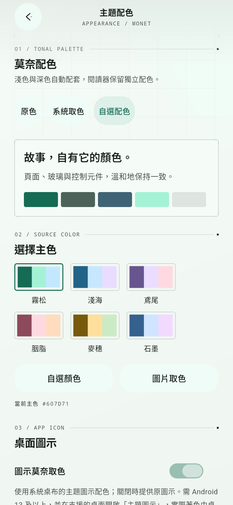

# LinoBunko · 嗶哩輕小說文庫本閱讀器（Linovelib Flutter）

**LinoBunko — Cross-platform Flutter Light Novel Reader for Linovelib (`tw.linovelib.com`) & Local Books (EPUB / TXT / MOBI / AZW3 / PDF / DOCX) — featuring Tablet Bunkobon (`105:148`) layout, Japanese/Chinese Tategaki (直排翻頁), 3D Bookshelf, Edge TTS Listening, WebDAV/S3 Sync, and Reading Statistics on Android, iOS & HarmonyOS.**

> [!IMPORTANT]
> **本專案僅為第三方閱讀用戶端，提供閱讀介面與本機書籍管理，不營運線上書庫、不自行發布小說資源，安裝包不附帶小說檔案。線上內容及可讀狀態一切以 tw.linovelib.com 為準；不提供因版權限制而停止開放的線上書籍閱讀。**
>
> **本應用程式完全免費、開源，無任何贊助、打賞或付費管道。** 不販售會員、啟用碼或功能解鎖服務。任何以本專案或開發者名義收費、募捐、索取贊助的行為均與本專案無關，請勿付款。
>
> **本分支將線上書源切換為嗶哩輕小說（Linovelib），同時支援本機多格式匯入；不再支援其他線上書源或自訂書源。** 支援 Android、iOS 與 HarmonyOS，並非嗶哩輕小說網站的官方應用程式。

<p align="center">
  <picture>
    <source media="(prefers-color-scheme: dark)" srcset="docs/images/readme-cover-dark.svg" />
    
  </picture>
</p>

<p align="center">
  <a href="https://github.com/Rynowastaken/LinoBunko/actions/workflows/flutter-ci.yml"></a>
  <a href="https://github.com/Rynowastaken/LinoBunko/releases/latest"></a>
  <a href="https://github.com/Rynowastaken/LinoBunko/releases"></a>
  
  
  
  
  
  <a href="assets/licenses/GPL-3.0.txt"></a>
</p>

奶白玻璃、檔案式排版、文庫本比例平板閱讀與立體書架。從發現一本書，到整理本機書庫、離線閱讀、區域網路續讀與線上聽書，讓每一次開啟都回到故事本身。

## 本分支特色 / Fork Highlights

基於上游 [mikufoxxx/Wenku8_Flutter](https://github.com/mikufoxxx/Wenku8_Flutter)（`v0.5.1`）分支改造，重點包含以下適配與最佳化：

### 1. 嗶哩輕小說（Linovelib）線上書源整合
- **完整唯讀目錄與正文適配**：線上書目發現、分類與排行瀏覽、出版文庫、詳情簡介、分卷目錄、多頁章節正文拼接、插圖載入與離線章節快取皆來自 [嗶哩輕小說](https://tw.linovelib.com/)。
- **簡繁搜尋與多級備援**：站點原生「搜尋」為 Google Programmable Search；應用程式內一般搜尋優先比對隨包索引 `assets/linovelib_catalog.json`（透過 OpenCC 支援簡體中文與繁體中文檢索），未命中時備援至 Brave 網頁搜尋，並支援於官網 CSE 搜尋、依分類瀏覽或直接輸入書籍 ID（`LN-xxxxx`）開啟。
- **獨立命名空間**：Linovelib 書目與章節使用獨立 ID 區間（`LN-xxxxx`），與本機匯入書籍及舊版紀錄互不衝突；該來源為公開唯讀目錄，不包含帳號登入、雲端書架、書評或簽到功能。

### 2. 平板與手機文庫本（Bunkobon）版式最佳化
- **直向平板單頁修正**：修正直向平板（如小米平板 6、iPad 等寬螢幕直向裝置）被強制拆分為雙欄對頁的問題——直向維持單頁專注排版，橫向或硬體雙螢幕鉸鏈裝置自動啟用雙頁對開。
- **文庫本（Bunkobon `105:148`）比例與緊湊排版**：平板與直向手機均保持純淨全螢幕紙面背景，依日式文庫本（A6 `105 mm × 148 mm`）比例置中顯示正文區域；在預設字級下自動採用更貼近實體文庫本的緊湊字級與行距（平板直排約 16–18 列，直向手機約 14–15 列），並將頁尾章節名與頁碼對齊正文左右邊緣。捲動模式在平板端同樣置中至文庫本閱讀欄寬。
- **空書架平板置中修正**：修正平板多欄格線下「書架還空著」空狀態偏移至左側欄的問題，使其於全寬中置中顯示。

### 3. 與上游版本跨端相容性說明 / Upstream Cross-Compatibility
- **區域網續讀（LAN Sync / `_wenkuread._tcp.` & `wenku-sync://`）**：可與上游 `Wenku8_Flutter` 裝置互相探索並配對；**本機匯入書籍（EPUB／TXT 等）可雙向傳書與同步閱讀進度**，但**線上書目與線上傳書續讀不相容**（LinoBunko 使用 `source: linovelib` 與獨立 `LN-` / `0x20000000+` 編號區間，與上游 `wenku8` 互相隔離，不會誤覆寫彼此的線上紀錄）。
- **雲端同步（WebDAV／S3）與本機備份（`.wenku8sync`／`wenku8-local-backup`）**：沿用相同備份／同步格式，本機書籍、書籤與書架分組可直接互通；但線上書源快取與書目僅限同書源版本各自讀取。
- **Android 套件與簽章**：本預覽發布版本使用 `org.mewx.wenku8_flutter.source_preview` 與 debug keystore 簽章，無法直接覆蓋上游簽章版本，安裝前請先匯出本機備份。

## 介面一覽

<p align="center">
  
  &nbsp;
  
  &nbsp;
  
</p>

<p align="center"><sub>發現故事　／　文庫本沉浸閱讀　／　依習慣自訂<br />介面書目為示範資料</sub></p>

## 下載與從原始碼建置 / Download & Build

前往 [GitHub Releases](https://github.com/Rynowastaken/LinoBunko/releases/latest) 下載對應架構的 Android APK：

| 裝置架構 | 建議安裝包 |
| :-- | :-- |
| 主流 Android 手機／平板（ARM64） | **`LinoBunko-v0.5.1-linovelib-arm64-v8a.apk`**（推薦） |
| 舊款 32 位元 ARM 裝置 | `LinoBunko-v0.5.1-linovelib-armeabi-v7a.apk` |
| x86_64 模擬器／裝置 | `LinoBunko-v0.5.1-linovelib-x86_64.apk` |
| 全架構通用包（Universal） | `LinoBunko-v0.5.1-linovelib-universal.apk` |

### 從原始碼建置 / Build from Source

```bash
git clone https://github.com/Rynowastaken/LinoBunko.git
cd LinoBunko
flutter pub get

# 建置 Android Release APK（建議搭配 JDK 17 以相容 Gradle 8.14）
flutter build apk --release --split-per-abi
```

- **Android** 會產生 `app-arm64-v8a-release.apk`、`app-armeabi-v7a-release.apk` 與 `app-x86_64-release.apk`。
- **iOS / HarmonyOS** 建置與簽章說明請參閱 [建置指南](docs/RELEASING.md)。

[完整更新說明](CHANGELOG.md) · [閱讀指南](docs/READER.md) · [搜尋指南](docs/SEARCH.md) · [回報問題](https://github.com/Rynowastaken/LinoBunko/issues)

## 閱讀，依你的習慣

- **橫排、直排（Tategaki）或捲動**：大螢幕橫向支援雙頁對開，曲面紙頁隨手指翻動、從書縫展開；亦可選擇段落接續、平移、覆蓋或無動畫，調整翻頁速度。平板端自動適配 `105:148` 文庫本比例。
- **一本書，一套排版**：字體、字級、字重、字距、行距與四邊頁邊距獨立儲存；縮排、對齊與背景濃度支援透明預覽。
- **讓顏色與字形合拍**：系統莫內取色、自選主色或圖片取色；閱讀器獨立配色與自訂背景。多款閱讀字體依需求下載、離線使用、隨時刪除，不預先內建閱讀字庫；亦可匯入 TTF／OTF，App 與閱讀器分別選擇。
- **隨時找到讀到哪裡**：分卷目錄、本章／整書進度、章內與整書搜尋、音量鍵翻頁、自動閱讀與跨章銜接。封面與插圖支援雙指縮放及原圖儲存。
- **雙語各取所需**：保留原書淺字樣式，依書選擇簡體／繁體顯示語言；朗讀語言獨立選擇，每種語言可單獨設定音色，缺少相符語音模型時略過。

## 把閱讀足跡，留成一張圖

- **分清每一種紀錄**：總覽、節律、書目、記號與觸控分類檢視，支援預設時間範圍與自訂日期；沒有資料的欄位與圖表自動省略。
- **報告不只是換顏色**：八套獨立版式，依需求選擇閱讀日曆、節律、相伴書單、進度與摘錄；預覽與匯出使用同一份內容。
- **為喜歡的句子留一頁**：書籤、批註、摘錄圖片與閱讀紀念；四季插圖隨實際季節切換，儲存圖片使用短暫提示。

## 桌面上，也有你的閱讀日常

今日閱讀、本週熱力、閱讀日曆、閱讀紀念與摘錄卡，搭配四季手帳等五種樣式。每張小工具獨立選擇內容與外觀，可同時放置多張；提供小、中、大三種尺寸與淺色／深色模式。

點擊統計進入統計頁，點擊最近閱讀繼續上次位置，摘錄卡可直接換下一則。Android 使用應用程式內設定，iOS 使用系統 WidgetKit 編輯入口，HarmonyOS 使用表單設定。

## 書庫，不止一種整理方式

- **立體與清單**：循環輪播、慣性吸附與觸覺回饋，也可只用清單。分類、閱讀狀態與書籍來源一起篩選；本機書庫可獨立管理，也可與書架合併。
- **先選擇，再匯入**：支援多選檔案、掃描共用儲存空間或指定資料夾；掃描後勾選書籍再匯入，同系列分卷統一確認合併。
- **預設關聯原檔案**：涵蓋現有支援格式，亦可選擇複製到應用程式；TXT 使用目錄索引，EPUB 依需求讀取資源，其他格式保留必要的轉換檔案與快取。請保留關聯的原檔案；檔案移動或權限失效後可重新關聯，保留進度與書籤。
- **保留原書的細節**：EPUB 注音、註解彈窗、常見對齊、分隔線與混合橫直排；TXT 可自訂目錄。線上書籍支援章節與插圖快取，不提供整書檔案下載或匯出。
- **批次整理，減少重複**：多選後移動分類、移出或刪除；更換封面、恢復原書封面，亦可手動升級舊 EPUB 排版與整理重複資源，保留原書、目錄、進度與書籤。

<details>
<summary><b>支援的格式與雲端匯入入口（EPUB / TXT / MOBI / AZW3 / PDF / WebDAV / S3）</b></summary>

支援 TXT、EPUB、MOBI／AZW／AZW3／PRC、FB2、PDF、DOC／DOCX、RTF、HTML、Markdown 與 ZIP。書名、作者、封面與分卷順序皆可調整。

可透過 OpenList／WebDAV、夸克網盤（實驗性）匯入；OneDrive、Google Drive 等可使用系統雲端文件入口，手動合併同步原書與閱讀紀錄。

[網盤匯入指南 →](docs/CLOUD_IMPORT.md)

</details>

## 讀到哪裡，都能接著讀

- **區域網路續讀**：同一 Wi-Fi 自動探索，首次兩端確認後自動重連。於「目錄 → 章節進度 → 在其他裝置上續讀」選擇裝置，缺書時一併傳送，已有同一本書時只傳送閱讀位置。
- **S3 雲端同步**：透過 S3／相容儲存空間手動合併原書、閱讀進度、書籤與分類；匯入連線與同步目的地分別設定。
- **離線查詞**：匯入 MDict、StarDict 或 Kindle 詞典，在閱讀時於本機查詞。
- **書籤與分類同步**：兩台 App 保持前景時自動接續較新的進度，增量同步書籤與分類；同時修改的紀錄可於衝突頁選擇保留。
- **留下喜歡的句子**：長按正文選句或段落，複製、加入書籤或快速檢視本卷插圖。書籤可分類、定位突顯，亦可分享成帶圖示浮水印的圖片。
- **換一種方式聽故事**：自然線上音色（Edge TTS）、自訂 Microsoft SSML 介面，或手機已安裝的系統 TTS 引擎。支援 0.5～3 倍速、段落跟隨、睡眠定時、背景與鎖定畫面控制；離線能力取決於引擎與音色。

<details>
<summary><b>更多：閱讀偏好、離線快取與效能設定</b></summary>

- **書籍發現**：分類、排行、出版文庫，依書名、作者、標籤或 ID 搜尋；點擊作者或標籤繼續瀏覽相關作品。[搜尋指南 →](docs/SEARCH.md)
- **閱讀操作**：分區點按可選左右兩側皆翻下一頁；發現、書架與本機頁可分別設定點書直接續讀，再從閱讀器進入詳情。
- **離線與備份**：失敗續快取、快取管理、閱讀歷史與本機備份。
- **主題圖示**：桌面圖示可跟隨系統主題取色，開關獨立控制。
- **中文支援**：簡體中文、香港繁體與台灣繁體，可跟隨系統或手動選擇。
- **使用方式**：可在 App 內強制直向顯示，不影響其他應用程式旋轉；無網路時保留可離線閱讀的書，閱讀器模式隨本機／合併書架設定連動。
- **效能與動效**：更新率偏好與低效能模式，玻璃折射、模糊、過渡、動態圖示與立體書架可分別調整；震動支援總開關，以及按鈕、書架等分類開關、強度與試震。

</details>

## 使用與內容說明

線上書目與內容來自嗶哩輕小說（`tw.linovelib.com`），本機書籍由使用者自行匯入。小說、封面與插圖歸各自權利人所有，原始碼授權不授予內容使用權。請僅使用有權存取的內容，遵守來源網站規則，不得繞過存取限制、破解 DRM，或未經許可複製、傳播、販售內容。

第三方服務可能調整、限流或停止。回報問題時請勿附帶密碼、Cookie 或權杖。

## 致謝與授權 / Credits & License

- **上游 Flutter 專案**：本儲存庫 Fork 自 [**mikufoxxx/Wenku8_Flutter**](https://github.com/mikufoxxx/Wenku8_Flutter)（`v0.5.1`），感謝原作者在 Flutter 閱讀引擎、直排排版、立體書架、統計報告、桌面小工具與本機多格式解析上的卓越工作。
- **原始 Android 專案**：上游專案基於 [MewX/light-novel-library_Wenku8_Android](https://github.com/MewX/light-novel-library_Wenku8_Android) 重構，感謝 MewX、Baby Pepper（SeraphRoy）、Jack Liu（aaassseee）及原專案貢獻者。
- **應用程式原始碼**：保留 [GPL v2 或後續版本聲明](LICENSE)，本 Flutter 組合版本依 [GPL v3](assets/licenses/GPL-3.0.txt) 散佈。
- **可下載字體**：遵循各自的 SIL OFL 1.1 授權。
- **線上語音適配**：[rany2/edge-tts](https://github.com/rany2/edge-tts)，[LGPL v3](assets/licenses/edge-tts.txt)。

[NOTICE](NOTICE) · [第三方元件說明](docs/THIRD_PARTY.md) · [LINUX DO 社群](https://linux.do/)

## Star History

<a href="https://www.star-history.com/?repos=Rynowastaken%2FLinoBunko&type=date&releases=&legend=bottom-right">
  <picture>
    <source media="(prefers-color-scheme: dark)" srcset="https://api.star-history.com/chart?repos=Rynowastaken/LinoBunko&type=date&theme=dark&legend=top-left" />
    <source media="(prefers-color-scheme: light)" srcset="https://api.star-history.com/chart?repos=Rynowastaken/LinoBunko&type=date&legend=top-left" />
    
  </picture>
</a>
